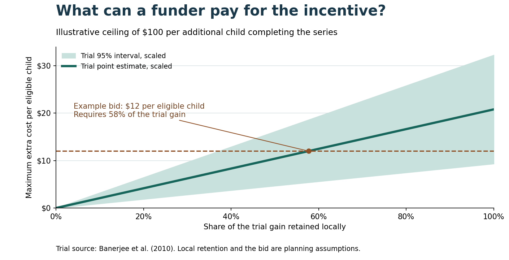

# What should a funder pay to add incentives to vaccination camps?

A program officer already funding reliable monthly camps needs to decide whether to pay for incentives as well. In a village-randomized trial in rural Rajasthan, **148 of 382** children in incentive villages completed the study's vaccination series, compared with **68 of 379** in camp-only villages. That is **20.8 additional completions per 100 eligible children**. A village-level uncertainty calculation gives an approximate 95% interval of **9.3 to 32.3** per 100. [Original trial](https://doi.org/10.1136/bmj.c2220) · [Reconstructed contrasts](results/contrasts.csv)

**A bid needs a local price and a local effect.** Suppose an implementer asks for **$12,000 extra to serve 1,000 eligible children**, and the funder will pay up to **$100 per additional completion**. That bid requires **120 additional completions**, or a **12-point improvement** over camp-only delivery. That is **58% of the trial's estimated gain**. If local delivery retains half the gain, the budget supports **$10.40 extra per eligible child**. These are illustrative terms. The funder supplies its own ceiling and the implementer supplies its costs.



## What to ask before funding

1. **How many children can the program serve?** Obtain the eligible population for the budget period, current completion with reliable camps, and the number of camps that actually open. At a starting coverage above 88%, a 12-point improvement is mathematically impossible.
2. **What does the incentive add to the bill?** Count procurement, storage, transport, distribution, staff time and additional clinic capacity. Deduct camp-only costs the funder already pays. Divide by all eligible children, including families that never attend.
3. **How will the funder learn whether the gain transfers?** A phased rollout with a contemporaneous camp-only comparison can estimate additional completions. Record the outcome for eligible children in both groups. A ledger of incentives distributed cannot establish that families completed the series because of the program.

## What the trial can support

| Endline group, ages 12–36 months | Villages with observed outcomes | Children completing / observed | Completion |
| --- | ---: | ---: | ---: |
| Existing services | 73 | 50 / 860 | 5.8% |
| Reliable monthly camp | 30 | 68 / 379 | 17.9% |
| Reliable camp plus incentive | 30 | 148 / 382 | 38.7% |

Giving every village equal weight yields a **16.1-point** incentive gain. Dropping one treatment or comparison village at a time gives **19.0 to 23.0 points** for the child-weighted result. Village weighting matters for a funder choosing between a target defined per child and one defined per village. Both estimates describe a historical trial in a low-coverage setting. A contemporary grant also needs evidence about local delivery, costs and baseline coverage. [Trial data](https://doi.org/10.7910/DVN/4IYQLO) · [Arm summaries](results/arms.csv)

## Price another proposal

From the repository root with Python 3.11:

```sh
python -m pip install -r requirements.txt
python price_bid.py --incremental-cost 12000 --eligible 1000 --ceiling 100
python analyze.py
python verify.py
```

The calculator accepts a total incremental budget in dollars, an eligible child count and a spending ceiling per additional completion. The analysis runs offline from anonymous village counts. The source-preparation command, uncertainty method, historical costs and sensitivity grid are documented separately. [Methods and provenance](METHODS.md) · [Nine pricing scenarios](results/budget.csv)

Independent portfolio reanalysis prepared with AI assistance. The fieldwork and original trial belong to Banerjee, Duflo, Glennerster and Kothari and their study partners.
